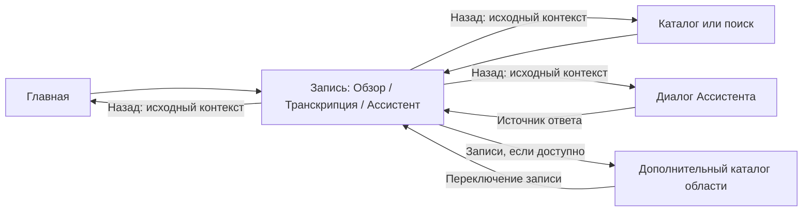

# Продукт и навигация Thesis

Документ описывает десктопный прототип Thesis по состоянию на 16 ноября 2026 года. Его задача — показать работу с записями встреч: получить запись, найти её в каталоге, прочитать материалы и задать по ним вопрос Ассистенту. Интерфейс имитирует окно приложения macOS, но не реализует нативное приложение.

Документ объясняет фактическую структуру текущей реализации. Для серверной разработки он задаёт наблюдаемое поведение интерфейса, а не подтверждённый серверный API или модель прав. Начальная точка всего комплекта — [HANDOFF.md](../../HANDOFF.md).

Задача первого этапа команды — перенос интерфейса и поведения на демоданных.
Реальные интеграции идут позже. Стартовый сценарий и принимаемые результаты —
в [главе 5](05-stage-one-acceptance.md). Открытые вопросы приёмки ниже
не считать утверждёнными требованиями; решение по ним нужно до приёмки соответствующего
входа, а не для начала переноса основного сценария библиотеки.

## 1. Термины, которые нельзя смешивать

| Понятие | Что означает здесь | Где смотреть |
| --- | --- | --- |
| Запись | Материал разговора с названием, источником, состоянием, транскрипцией и резюме. Готовая запись и черновик — разные сущности. | `Recording`, `Draft` в [types.ts](../../src/types.ts) |
| Источник записи | Как запись появилась: диктофон (`microphone`), файл (`file`) или ВКС (`conference`). Это не её папка и не источник ответа Ассистента. | `Source` в [types.ts](../../src/types.ts), `RecordSource` в [Library.tsx](../../src/Library.tsx) |
| Пространство | Область размещения записей. «Личное» представлено специальным `areaId='personal'`; общие пространства имеют собственный ID. `legacy` обозначает совместимость с ранее сохранёнными папками без пространства. | `ListScope`, `areaAvailable`, `workspaceList` в [types.ts](../../src/types.ts) и [model.ts](../../src/model.ts) |
| Папка | Уточняет размещение внутри пространства. В адресах значение `root` означает записи без папки, а не отдельную сохранённую папку. | `Folder`, `ListScope` в [types.ts](../../src/types.ts) |
| Область списка | `all`, `area` или `folder`. Определяет, какой каталог открыт. | `ListScope`, `scopeKey` в [navigation.tsx](../../src/navigation.tsx) |
| Фильтры списка | Запрос, источник, состояние, пространство, папка, сортировка и прокрутка поверх открытой области списка. | `Filters` в [types.ts](../../src/types.ts), `listState` в [navigation.tsx](../../src/navigation.tsx) |
| Источники Ассистента | Набор материалов, по которым задаётся вопрос. Выбор источников может отличаться от открытого каталога и размещения записи. | `Scope`, `Snapshot` в [types.ts](../../src/types.ts), [Assistant.tsx](../../src/Assistant.tsx) |
| Контекст возврата | Место, из которого открыта запись: каталог, результаты поиска, главная или диалог. Не вычисляется заново из текущего размещения записи. | `returnTarget`, `closeDetail` в [navigation.tsx](../../src/navigation.tsx) |
| Вкладки материалов | «Обзор», «Транскрипция», «Ассистент» внутри одной записи. | `RecordPage` в [RecordPage.tsx](../../src/RecordPage.tsx) |
| Рабочие вкладки | Несколько одновременно открытых рабочих страниц приложения. В интерфейсе их панели нет. Имена реализационных структур `WorkspaceTab`, `activeTabId` и методы навигации не означают наличие этой функции. | `NavigationProvider` в [navigation.tsx](../../src/navigation.tsx) |

## 2. Структура интерфейса

Обычная страница состоит из навигации окна сверху, глобальной боковой панели и содержимого выбранного раздела. В боковой панели находятся «Главная», «Все записи», «Ассистент», каталог пространств, личное пространство, общие пространства и «Настройки». В настройках боковая панель заменяется перечнем разделов настроек и действием возврата в приложение.

При открытии записи интерфейс переходит в режим чтения: глобальная боковая панель скрывается. Слева в панели окна остаются «Назад» и, когда известен надёжный контекст каталога, переключатель «Записи». Справа находятся действия записи и передача резюме. Ниже расположены вкладки материалов, их содержимое, переключатель свойств и общий нижний плеер. Список записей и свойства можно открыть дополнительно; это не обязательная постоянная композиция из трёх колонок.

Это схема переходов, а не буквальная маршрутизация одного объекта обратно сразу в три места. Реальная цель «Назад» зависит от входа в конкретную запись.

Основные владельцы композиции: `DesktopApp`, `UnifiedWindowToolbar`, `WindowNavigation` и `Sidebar` в [App.tsx](../../src/App.tsx); дополнительные панели — [FocusRecordList.tsx](../../src/FocusRecordList.tsx) и [RecordPage.tsx](../../src/RecordPage.tsx). Оконная рамка задаётся в [index.html](../../index.html); служебная внешняя шапка прототипа удалена.

## 3. Карта экранов и адресов

Приложение использует hash-маршруты. Например, полный адрес каталога — `https://thesis-desktop-demo.vercel.app/?preview=1#/records`. `preview=1` относится к параметрам страницы перед `#`. Параметры после пути внутри `#` передают контекст каталога записи или диалога.

Пути формируют и разбирают `routePath` и `parseRoute` в [navigation.tsx](../../src/navigation.tsx). ID кодируются через `encodeURIComponent`; нельзя собирать путь подстановкой непроверенного названия пространства вместо его ID.

| Экран | Hash-путь | Реализация и нюансы |
| --- | --- | --- |
| Главная | `#/home` или пустой hash | [MeetingHome.tsx](../../src/MeetingHome.tsx): примеры ближайших встреч, продолжение работы, недавно созданные записи. |
| Все записи | `#/records` | `Library`, область `all`. В одном списке могут быть записи, черновики и ещё не завершённые подключения встреч. |
| Каталог пространств | `#/spaces` | `WorkspacesPage` в [Pages.tsx](../../src/Pages.tsx). Включает личное пространство; здесь доступно создание нового пространства. |
| Записи пространства | `#/spaces/{areaId}` | `Library`, область `area`. Это каталог пространства, не карточка его настроек. |
| Записи папки | `#/spaces/{areaId}/folders/{folderId}` | `Library`, область `folder`. `root` — «Без папки» для личного/legacy или «В корне пространства» для общего пространства. |
| Управление папками | `#/spaces/{areaId}/folders` | `FoldersPage` в [Pages.tsx](../../src/Pages.tsx). Для ранее сохранённых папок без области используется `#/spaces/legacy/folders`. |
| Участники | `#/spaces/{areaId}/members` | `MembersPage` в [Pages.tsx](../../src/Pages.tsx). Наличие этого экрана не подтверждает реализованную серверную ACL. |
| Поиск во всех записях | `#/search/all` | `Library` с `searchMode`. Строка запроса не включена в URL. |
| Поиск в пространстве | `#/search/area/{areaId}` | Та же страница поиска в области пространства. |
| Поиск в папке | `#/search/folder/{areaId}/{folderId}` | Та же страница поиска в области папки. |
| Материалы записи | `#/records/{id}/{section}` | `section`: `summary`, `transcript`, `assistant`. В интерфейсе `summary` называется «Обзор». Без корректного section открывается обзор. |
| Диктофон | `#/recorder/{draftId}` | `RecorderPage` в [creation.tsx](../../src/creation.tsx). ID относится к черновику. |
| Подключение встречи | `#/meetings/{meetingId}` | `MeetingPage`; после появления результата может показывать материалы созданной записи. Допустим суффикс `/transcript` или `/assistant`. |
| История глобального Ассистента | `#/assistant` | `Assistant` без `id`. |
| Глобальный диалог | `#/assistant/{dialogId}` | `Assistant` с `id`. Источники берутся из сохранённого диалога, не из этого пути. |
| Ассистент области | `#/spaces/{areaId}/assistant` и `.../{dialogId}` | Область навигации передаётся также в query. Папка дополнительно передаётся как `folder`. |
| Настройки | `#/settings/{section}` | `connection`, `appearance`, `account`, `recording`, `notifications`, `storage`; при отсутствии section используется `connection`. |

Пример адреса записи из поиска в папке: `#/records/{id}/transcript?area=project&folder=project-planning&search=1`. Он сохраняет ID области и признак поиска. Сам запрос, набор фильтров, прокрутка и исходная строка списка в адрес не входят.

`RecordSection` и валидатор истории допускают значение `details` при восстановлении сохранённых данных. `parseRoute` не открывает отдельную вкладку details: она нормализуется к обзору, а свойства открываются своей кнопкой. Не добавляйте на основании этого типа четвёртую вкладку материалов. Неизвестный или не декодируемый путь возвращает маршрут всех записей.

## 4. Каталог, фильтры и поиск

`Library` использует одну композицию для общего каталога, пространства, папки и отдельной страницы поиска. Список строится через `filterRecords`, `filterDrafts`, `filterMeetings` и затем сортируется по дате либо названию. Разные типы строк открывают разные экраны: запись — материалы, черновик — диктофон, подключение — страницу встречи.

Счётчики отражают разные наборы. Счётчик пространства в боковой панели и его заголовке использует `areaRecordCount`: записи области с учётом папок, без черновиков и подключений. Общий счётчик «Все записи» включает видимые записи, черновики и незавершённые подключения; подпись результатов в таблице перечисляет эти типы отдельно. Дополнительная панель «Записи» считает только записи своего каталога. Не заменяйте их одним общим `rows.length` без проверки смысла каждой подписи.

У каждой области есть собственное состояние каталога и собственное состояние страницы поиска. Ключ включает ID внутренней рабочей сессии, `list:` или `search:`, а затем `scopeKey(scope)`. Поэтому фильтры «Все записи» и фильтры конкретной папки не являются одним общим объектом. Поиск во всех записях и строка поиска внутри каталога всех записей тоже хранятся отдельно.

Поведение фильтров в текущем коде:

- Изменение запроса, сортировки или фильтра сбрасывает прокрутку списка в начало.
- Быстрый выбор пространства существует в общем каталоге. При смене пространства фильтр папки сбрасывается в `all`.
- Модальное окно фильтров редактирует промежуточное состояние: «Применить» переносит его в список, «Отмена» не применяет.
- «Сбросить фильтры» сохраняет текст запроса и сортировку; «Очистить поиск» очищает только запрос. Действия возвращают фокус соответственно к кнопке фильтров и полю поиска.
- Пустой результат не расширяет область поиска автоматически. Переход «Искать во всех записях» является явным действием.
- Если область больше недоступна, вместо каталога показывается соответствующее пустое состояние и путь ко всем записям.
- Удалённая папка, оставшаяся в фильтре, сбрасывается; существование пространства и папки проверяется отдельно от текстовой строки URL.
- Когда в области вообще нет строк, поиск и фильтры недоступны. Пустая область и пустой результат фильтра — разные состояния.

Нажатие `Cmd+K` или `Ctrl+K` обрабатывает оболочка. На видимой странице списка оно фокусирует имеющееся поле. Из записи — возвращает к исходной странице поиска, если она была открыта в той же сессии, либо открывает поиск в ближайшей известной области. Из прямой ссылки с `area`/`folder` можно открыть поиск в указанной области. При видимом диалоге сочетание не уводит со страницы и не теряет введённые в диалоге данные.

В таблице клавиши стрелок, `J`/`K`, `Home`/`End` перемещают фокус по кнопкам строк; `Enter` активирует выбранную строку стандартным поведением кнопки. Это управление фокусом, не фоновое открытие материалов при каждом нажатии стрелки.

Код: `Library`, `FilterDialog`, `moveListFocus` в [Library.tsx](../../src/Library.tsx); `openSearch`, `listState`, `updateList`, `captureListScroll` в [navigation.tsx](../../src/navigation.tsx).

## 5. Открытие записи, переключение и возврат

### Из каталога или результатов поиска

1. Строка вызывает `openRecord(id, scope, searchMode)`.
2. Перед скрытием списка навигация синхронно считывает его реальную прокрутку. Это защищает и быстрый клик, и переход с клавиатуры, когда очередное событие `scroll` ещё не обработано.
3. Если запись уже открывали в текущей сессии, восстанавливается выбранный материал; иначе открывается обзор.
4. Переход помечается как вход из надёжного списка. В режиме записи можно открыть дополнительную панель «Записи».
5. Переключение материалов или переход к другой записи заменяют текущую детальную страницу в логической истории, сохраняя исходную цель возврата.
6. «Назад» вызывает `closeDetail`: восстанавливает исходный каталог/поиск, его запрос, фильтры и прокрутку. Фокус возвращается на исходную строку; если она больше не входит в список, запасной точкой является поле поиска.

Таким образом, цепочка «поиск “комитет” → запись А → другая запись Б → Назад» возвращает к поиску “комитет”, а не к записи А и не к месту хранения записи Б.

### Что показывает дополнительная панель «Записи»

Это полный каталог текущей области, отсортированный от новых записей к старым. Он строится через `filterRecords(state, scope, DEFAULT_FILTERS)` в [FocusRecordList.tsx](../../src/FocusRecordList.tsx). Панель не повторяет текстовый запрос, фильтры источника/статуса и сортировку страницы входа; черновики и подключения встреч в неё не включаются.

Например, из результата “Проектный комитет” в общем поиске панель позволит открыть «Оперативное совещание». При возврате исходный поисковый запрос сохранится. Если запись переименовали и она перестала соответствовать запросу, из панели каталога она не исчезает только из-за этого изменения, а исходный результат поиска корректно может стать пустым.

Заголовок панели отражает область (`Все записи`, пространство или папку), а не название поискового запроса. Если текущая запись перестала входить в область каталога, оболочка умеет показывать сообщение «Открытая запись не входит в этот список».

### С главной

Входы «Недавно созданные» и ошибки из «Продолжить работу» передают `HomeFocusList`. Это маркер известного входа в текущей сессии; сейчас панель «Записи» из этих входов также показывает все записи, а не только шесть недавних или только ошибки. «Назад» возвращает на главную и восстанавливает её прокрутку и исходный элемент фокуса. Наличие `recordIds` в `HomeFocusList` не означает, что отображаемая панель ограничивается этим массивом.

### Из ответа Ассистента

Открытие источника ответа помечается `assistantSource`. Панель «Записи» в таком входе не предлагается: навигация не подменяет источник ответа придуманной подборкой. «Назад» возвращает к исходному диалогу. Положение диалога и источник, на котором был фокус, поддерживаются через `DialogView`; переход к источнику не равен изменению настроенных источников диалога.

### Прямая ссылка и перезагрузка

Прямая ссылка знает запись и, возможно, `area`/`folder`/`search=1`, но не знает прежние фильтры и прокрутку. В таком входе кнопка «Записи» скрыта. «Назад» имеет безопасную цель — соответствующий каталог/поиск из адреса, либо все записи, если контекст отсутствует.

После перезагрузки действуют те же ограничения. История может восстановить маршрут и стек возврата, но маркеры надёжного списка, фильтры и карты просмотров живут в памяти `NavigationProvider`. Прототип не реконструирует каталог из одного `area` и не утверждает, что восстановил прежнюю поисковую выборку.

Код: `go`, `commit`, `returnTarget`, `openRecord`, `closeDetail`, `reliableListEntries`, `homeListEntries` в [navigation.tsx](../../src/navigation.tsx); `canShowFocusRecordList` в [FocusRecordList.tsx](../../src/FocusRecordList.tsx).

## 6. История, адрес и срок жизни состояния

Верхние кнопки «Назад по истории»/«Вперёд по истории» относятся к ограниченной истории приложения, которую ведёт `NavigationProvider`. Это не счётчик всей внешней истории браузера. Новая ветка переходов обрезает её прежнее продолжение.

В `history.state` записываются маршрут, стек возврата, признак входа из Ассистента и снимок `thesisWorkspaceTabs`. Снимок валидирует [workspace-session.ts](../../src/workspace-session.ts): проверяются типы, размеры, ID активной записи, пределы индексов и соответствие текущему адресу. Несовпадающий или повреждённый снимок игнорируется. Явно открытый адрес имеет приоритет. При восстановлении приложение использует только активную внутреннюю рабочую сессию и не открывает дополнительные рабочие вкладки.

| Состояние интерфейса | Где живёт | После обычного перехода внутри приложения | После перезагрузки |
| --- | --- | --- | --- |
| Открытый маршрут и цель возврата | `history.state`, валидируемый снимок | Сохраняются с правилами `go`/`commit` | Могут восстановиться, если снимок валиден и соответствует адресу |
| Запрос, фильтры, сортировка и прокрутка списка | `lists` в `NavigationProvider` | Сохраняются отдельно по области и режиму поиска | Не восстанавливаются из URL или снимка истории |
| Выбранный материал записи, прокрутка материалов, поиск/фильтр спикера, незавершённая правка | `recordViews` в `NavigationProvider` | Сохраняются по внутренней сессии, серверу, владельцу и ID записи | Не являются постоянными пользовательскими настройками |
| Положение диалога и источник фокуса | `dialogViews` в `NavigationProvider` | Сохраняются при переходе к источнику и обратно | Не гарантируются после перезагрузки |
| Надёжность исходного списка и маркер входа с главной | `WeakSet`/`WeakMap` текущего provider | Сохраняются в цепочке детального просмотра | Теряются; кнопка списка скрывается |
| Открытие дополнительного списка | локальный `listOpen` в оболочке | Сохраняется при переключении записей; закрывается при выходе из детальных маршрутов | Закрыт |
| Настройка свойств | `propertiesOpen` и `thesis-home-properties` в обычном режиме | Применяется к следующим открытым записям | На широком окне берётся сохранённое значение; preview и узкий старт имеют свои правила |

Сохранённые данные самих записей и диалогов — другой слой, описанный в документе об архитектуре и модели данных. Не переносите transient UI-состояние в серверный контракт без отдельного решения.

## 7. Широкое и узкое окно

«Узкое окно» в этих файлах означает адаптацию десктопного интерфейса. Оно не является мобильной версией Thesis. Пороговые значения здесь различаются, потому что решают разные задачи:

| Условие | Текущее поведение | Владелец |
| --- | --- | --- |
| Ширина окна `≤1150px` на обычных страницах | Глобальная навигация открывается кнопкой в VINi Sheet. Sheet ограничен рамкой приложения, закрывается по Escape/внешнему клику; фокус возвращается к кнопке. При переходе в настройки в нём показываются разделы настроек. | `WindowNavigation`, `SidebarProvider` в [App.tsx](../../src/App.tsx) |
| Открытая запись | Глобальная навигация скрыта независимо от ширины окна. | `focused`, `meeting-focus` в [App.tsx](../../src/App.tsx), [focus-shell.css](../../src/focus-shell.css) |
| Ширина окна `≤1100px` | Дополнительный список записей накладывается на содержимое слева. В более широком окне он занимает отдельную колонку 300px. | `useOverlay` в [FocusRecordList.tsx](../../src/FocusRecordList.tsx), [focus-record-list.css](../../src/focus-record-list.css) |
| Ширина окна `<1000px` | Свойства записи используют узкую накладываемую панель; при первичном открытии приложения на такой ширине она закрыта. Ширина панели ограничена `min(337.5px, 45vw)`. | `RecordPage`, [focus-shell.css](../../src/focus-shell.css) |
| Доступная ширина содержимого `<1100px`, свойства и список открыты | Открытие свойств закрывает список. Но пользователь может затем явно открыть список поверх записи и оставить свойства видимыми. | `changeProperties` в [App.tsx](../../src/App.tsx) |
| Доступная ширина пересекает 1100px сверху вниз, когда обе панели открыты | Список закрывается, свойства остаются. Если фокус был внутри списка, он возвращается к переключателю «Записи». | `previousAvailable` в [App.tsx](../../src/App.tsx) |

Порог доступного содержимого вычисляется по `clientWidth` контейнера через `ResizeObserver`; он не всегда равен ширине окна браузера. Поэтому две панели могут потребовать компактного поведения и в широком окне.

Закрытие списка кнопкой или Escape из списка возвращает фокус на «Записи». Escape внутри свойств закрывает их и возвращает фокус на кнопку свойств. Действия оконного toolbar остаются доступны на 900px и 1280px. Предложенные вопросы встроенного Ассистента меняют раскладку по доступной ширине содержимого, в том числе при открытии панелей.

В коде есть `ListPaneDivider`, размер списка из `sessionStorage` и split-композиция. `openMode` фиксирован как `full`: эти структуры не предоставляют пользователю переключатель split/full или изменение ширины панели `FocusRecordList`.

## 8. Точки входа в создание записи и Ассистента

`RecordingAction` определяет место отправки из открытого каталога. Все записи и legacy-каталог направляют новую запись в «Личное». Пространство направляет её в это пространство; открытая папка или выбранный фильтр папки в пространстве задают папку. `all`/`root` превращаются в отсутствие папки. Назначение сообщается в tooltip и доступном описании кнопки; в диктофоне его можно изменить явно. `startRecording` проверяет доступность пространства и папки до создания черновика.

В отдельном поиске кнопки создания не показываются. В текущем коде «Записать» и «Добавить» есть также на главной; главная использует личную область. В `AddMenu` выбранная папка передаётся диктофону, но диалоги импорта файла и встречи получают только `initialArea`; не следует предполагать, что все три способа создания автоматически сохраняют одну и ту же папку.

Контекстный Ассистент текущего кода доступен в каталоге пространства и в настоящей открытой папке (не `root`), а глобальный — из боковой панели. Папка задаёт источники диалога по своему scope независимо от фильтров таблицы. Ассистент записи находится на третьей вкладке материалов и связан с фиксированным контекстом записи. Подробные правила выбора источников и снимков вопросов описываются в документе сценариев и состояний.

При попытке уйти из диктофона с существующим черновиком навигация задерживает переход. Диалог предлагает сохранить черновик и выйти, завершить и отправить, удалить и выйти либо продолжить запись. Пока пользователь выбирает действие, локальная запись не останавливается автоматически; пауза/завершение происходят только после соответствующего выбора. См. `guardedTabAction`, `go`, `traverse` и диалог выхода в [navigation.tsx](../../src/navigation.tsx), [RecordingAction.tsx](../../src/RecordingAction.tsx), `AddMenu` в [Library.tsx](../../src/Library.tsx).

## 9. Хлебные крошки и управление диалогом

На обычных страницах `PageNavigation` строит путь по текущему маршруту: все записи, пространство/папка, настройки и раздел. У глобального и контекстного Ассистента остаётся один уровень «Ассистент». В открытом диалоге этот уровень возвращает к истории соответствующего контекста. Переключатель истории находится в заголовке содержимого диалога; он предлагает все диалоги, новый диалог и существующие беседы, сохраняя их отдельные черновики.

В фокусном просмотре записи общие крошки заменены действием «Назад», а действия записи монтируются в оконный toolbar через portal. `RecordBreadcrumbs` остаётся запасной композицией для случая, когда хост toolbar не найден; он умеет сворачивать промежуточные уровни по измеренной ширине. Наличие этого компонента в коде не означает, что полный путь сейчас постоянно показывается над каждой записью.

Код: [PageNavigation.tsx](../../src/PageNavigation.tsx), `recordActions`/`toolbarTarget` в [RecordPage.tsx](../../src/RecordPage.tsx), [RecordBreadcrumbs.tsx](../../src/RecordBreadcrumbs.tsx), заголовок разговора в [Assistant.tsx](../../src/Assistant.tsx).

## 10. Что требует сохранения и что ещё требует решения

Поведение, уже выраженное кодом и целевыми тестами, следует переносить в рабочее приложение как целые сценарии: независимые scopes, явная цель возврата, восстановление фильтров в живой сессии, отсутствие придуманной подборки после reload, независимость размещения записи и источников Ассистента, возвращение фокуса при закрытии панелей. Нельзя свести перенос к копированию отдельных экранов.

Три точки входа требуют подтверждения владельцем продукта до их отдельной приёмки. Здесь зафиксировано, как они работают сейчас и какой вопрос нужно решить:

| Тема | Текущее поведение | Вопрос приёмки |
| --- | --- | --- |
| «Записать» на главной | Присутствует в `MeetingHome`, новая запись направляется в личную область. | Подтвердить наличие этого действия на главной до приёмки входа. |
| Контекстный Ассистент в корне пространства | Доступен для `scope.kind='area'`. | Подтвердить вход из корня пространства до его приёмки. |
| Список при входе с главной | Предлагается при переданном `HomeFocusList` в живой сессии; показывает все записи. Это поведение проверяют focus-тесты. | Подтвердить доступность панели и состав её записей для этого входа. |

Текущее поведение этих входов не считать утверждённым требованием. До их
отдельной приёмки владелец продукта должен подтвердить правило. Стартовый сценарий
библиотеки от этих входов не зависит. Изменение выбранного поведения затем
синхронно отражается в коде, актуальных тестах и этом документе. Статусы решений —
в [главе 5](05-stage-one-acceptance.md).

## 11. Как проверять перенос навигации

Основные доказательства сценариев находятся в [focus-navigation.spec.ts](../../tests/focus-navigation.spec.ts) и [adaptive-window.spec.ts](../../tests/adaptive-window.spec.ts). Этот документ составлен чтением кода и тестов; он не является отчётом о повторном запуске всего набора.

При реализации проверить как минимум:

1. Открытие записи из каталога, поиска, пространства, папки, главной и источника диалога; у каждого входа своя цель «Назад».
2. Переключение двух записей в панели и последующий возврат сохраняют исходный запрос и прокрутку; после переименования исходная строка может исчезнуть из результатов, но каталог панели остаётся корректным.
3. Прямая ссылка и reload не включают панель с выдуманными фильтрами. Адрес с `area`/`folder` возвращает в правильную область.
4. `Cmd/Ctrl+K` из записи открывает нужную область поиска, возвращает фокус и не закрывает диалоги с незавершённым вводом.
5. Список и свойства корректно открываются/закрываются при 900px и 1280px; уменьшение окна сохраняет доступный способ продолжить работу.
6. Черновик диктофона не теряется из-за перехода, а показ диалога выхода сам по себе не завершает запись.
7. Встроенный Ассистент и глобальная история обращаются к правильному диалогу; переход к источнику и обратно сохраняет контекст разговора.

Для проверки навигации использовать конфигурации `tests/focus-navigation.config.ts` и `tests/adaptive-window.config.ts` с уже работающим портом 4192 и `?preview=1`. Полный перечень проверок этого проекта находится в [главе 4](04-development-delivery.md).
