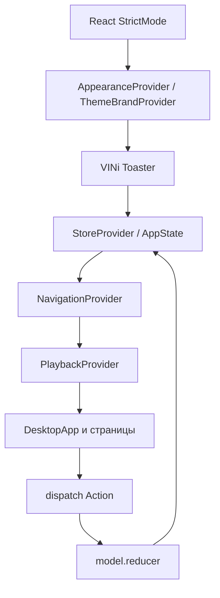
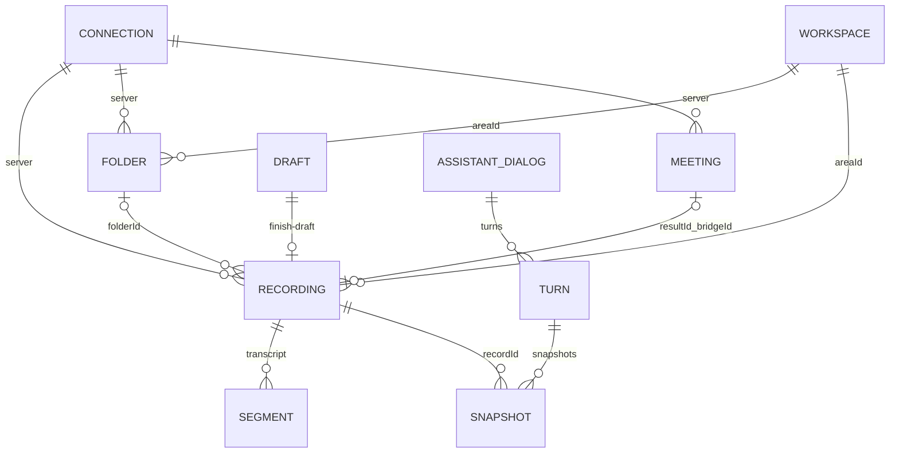
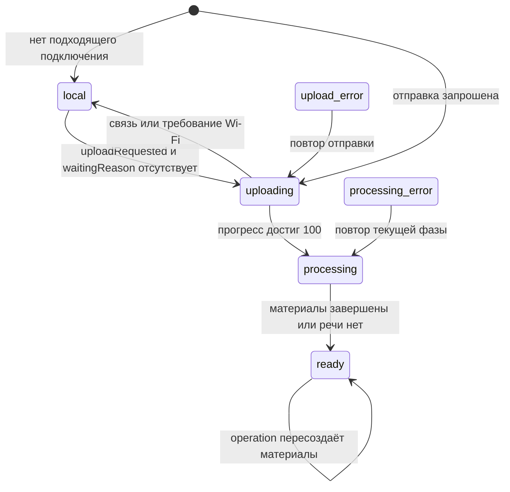

# Архитектура и модель данных

Этот документ описывает архитектуру десктопного прототипа Thesis по состоянию
на 16 ноября 2026 года. Он нужен разработчику, который переносит интерфейс и
поведение и разбирается в устройстве демонстрационной модели. Маршруты и правила
возврата описаны отдельно в [карте продукта и навигации](01-product-navigation.md).

Текущая реализация — React-приложение в браузере. Состояния отправки, обработки,
входа и диалогов изменяются локальным редьюсером. Настоящего API Thesis,
нативного хранилища медиа и фонового сервиса здесь нет. Поэтому ниже отдельно
указаны существующие правила прототипа и решения, которые ещё нужны для
промышленного клиента.

## 1. Как запускается приложение

Стек зафиксирован в [package.json](../../package.json): React 18.3.1,
TypeScript, Vite, VINi `0.1.0-alpha.14`, `react-markdown` и `remark-gfm`.
`npm run build` сначала проверяет типы через `tsc --noEmit`, затем собирает
статические файлы Vite. Сервер и порт задаются в
[vite.config.ts](../../vite.config.ts).

[src/main.tsx](../../src/main.tsx) создаёт корень React. Порядок CSS-импортов:
шрифты, темы и типографика VINi → локальные `tokens.css` и `styles.css` →
`@vini-ds/ui/styles.css` → `vini-layout.css` и `settings-recovery.css`.
Дополнительные CSS подключаются из модулей экранов. Иерархия провайдеров:

Это несколько разных видов состояния, а не одна общая сессия:

| Слой | Что содержит | Где живёт |
| --- | --- | --- |
| Данные приложения | Записи, черновики, подключения, диалоги, пространства, настройки и демовход | `AppState`, `StoreProvider`, `localStorage` вне preview |
| Навигация | Текущий маршрут, история возврата, состояние подборок, вид записи | `NavigationProvider`, память и ограниченный снимок `history.state` |
| Воспроизведение | Активная запись, позиция, скорость, состояние play/pause | `PlaybackProvider`, память |
| Оформление | Тема, палитра, демонстрационный выбор языка | `AppearanceProvider`, отдельный ключ `localStorage` |
| Локальный интерфейс | Открытая панель, диалог, черновик поля, фокус | `useState`/`useRef` конкретной страницы |

Изменение маршрута само по себе не меняет записи и не удаляет диалоги. Смена
оформления не меняет сервер. Не стоит объединять эти слои при переносе в новый
клиент: у них разные сроки жизни и правила восстановления.

## 2. Карта модулей

| Файл | Ответственность |
| --- | --- |
| [types.ts](../../src/types.ts) | Доменные типы `AppState`, сущностей, источников, фильтров и `Route` |
| [model.ts](../../src/model.ts) | Селекторы доступности, валидация, `Action`, `reducer`, таймерная модель обработки и ответов |
| [store.tsx](../../src/store.tsx) | Инициализация/восстановление `AppState`, сохранение, секундный `tick`, уведомления |
| [fixtures.ts](../../src/fixtures.ts) | Исходные вымышленные записи, участники, сервер, владелец и примеры состояний |
| [demoScale.ts](../../src/demoScale.ts) | Версионируемое добавление вымышленных пространств и длинных списков |
| [navigation.tsx](../../src/navigation.tsx) | Разбор адреса, переходы, история, возврат, состояние подборок и представлений записи |
| [workspace-session.ts](../../src/workspace-session.ts) | Проверка и копирование снимка истории браузера |
| [App.tsx](../../src/App.tsx) | Сборка оболочки, выбор страницы, расположение списка/свойств/плеера, адаптация ширины |
| [Library.tsx](../../src/Library.tsx), [FocusRecordList.tsx](../../src/FocusRecordList.tsx) | Полная библиотека и дополнительный компактный список в записи |
| [RecordPage.tsx](../../src/RecordPage.tsx) | Материалы записи, транскрипция, сведения, связанный Ассистент |
| [Assistant.tsx](../../src/Assistant.tsx) | История и интерфейс диалога, выбор источников, отправка/остановка/повтор |
| [creation.tsx](../../src/creation.tsx) | Импорт, имитация диктофона и подключения агента |
| [Pages.tsx](../../src/Pages.tsx) | Пространства, папки, участники, вход и настройки |
| [record-actions.tsx](../../src/record-actions.tsx) | Действия над записью и подтверждения |
| [record-export.ts](../../src/record-export.ts), [RecordExport.tsx](../../src/RecordExport.tsx) | Локальное формирование текстовых файлов и интерфейс экспорта |
| [playback.tsx](../../src/playback.tsx) | Единая имитация плеера и видеоблока |
| [ui.tsx](../../src/ui.tsx) | Общие продуктовые адаптеры поверх публичных компонентов VINi |
| [appearance.tsx](../../src/appearance.tsx) | Выбор темы/палитры и подключение `ThemeBrandProvider` |
| [workspaceOwner.ts](../../src/workspaceOwner.ts) | Показ только явно известного владельца, без вывода из роли администратора |

`App.tsx` загружает часть страниц через `React.lazy` и `Suspense`. Это разделение
статической сборки на чанки, а не отдельные приложения или серверные сервисы.
Имя реализационной структуры не определяет доступную пользователю функцию.
Например, `workspace-session.ts` содержит `WorkspaceTab`, но приложение
восстанавливает только одну активную рабочую область без полосы рабочих вкладок.

## 3. Сущности и связи

Точные объявления находятся в [types.ts](../../src/types.ts). `AppState.version`
сейчас равен `1`; `demoScaleVersion` — независимая версия демонстрационного
наполнения.

Диаграмма показывает ссылки по идентификаторам, а не ограничения базы данных.
В прототипе нет БД с внешними ключами. `personal`, `all`, `legacy` и `root` —
служебные значения областей/подборок, а не обычные объекты `Workspace`.

### Запись `Recording`

| Поля | Смысл |
| --- | --- |
| `id`, `title`, `createdAt`, `updatedAt?` | Идентичность, название и даты |
| `source` | Происхождение: `microphone`, `file`, `conference`; не место хранения и не круг доступа |
| `server`, `areaId`, `folderId` | Сервер и расположение; папка необязательна; `areaId: null` поддерживает ранее сохранённые записи без пространства |
| `duration` | Длительность в секундах; `null` означает, что она не определена |
| `status`, `processing?`, `operation?` | Стадия жизненного цикла, текущая фаза и повторная операция |
| `transcript`, `summary` | Текстовые материалы; наличие массива/строки само по себе ещё не означает доступность материала |
| `materials` | Флаги доступности транскрипции и резюме, дополнительно проверяемые `materialAvailable` |
| `transcriptRevision`, `summaryRevision` | Версии материалов; меньшая версия резюме означает устаревание относительно транскрипции |
| `uploadProgress?`, `uploadRequested?` | Демонстрационная отправка и намерение возобновить её |
| `canManage?`, `canExport?` | Локальные ограничения интерфейса, не подтверждённые серверные права |
| `frozen?`, `noSpeech?`, `bridgeId?` | Остановка движения демофикстуры, результат «нет речи», связь с подключением встречи |

`Segment` содержит `id`, `speaker`, `color`, `start`, `end`, `text`. Таймкоды —
числа секунд из демонстрационного материала. Имя спикера не равно участнику
пространства или проверенной личности.

### Черновик `Draft`

Это самостоятельная незавершённая запись: `id`, `title`, `seconds`, `paused`,
`createdAt`, `server`, `areaId`, необязательный `folderId`. Завершение черновика
создаёт новую `Recording` и удаляет именно этот `Draft`. Черновик не хранит
аудиобайты. Создание/возобновление одного черновика ставит остальные на паузу.

### Пространство и папка

- `Workspace` содержит название, описание, цвет и демонстрационных `members`.
- `CreatedWorkspace` дополнительно содержит `server`, `owner` и
  `invitationDrafts?`. Создание пустого пространства допустимо.
- Правки демонстрационных названия/описания и состава участников могут жить в
  отдельных массивах `workspaceDetails` и `memberSelections`, привязанных к
  `workspaceId + server + owner`.
- `Folder` содержит `id`, `name`, `areaId`, `server`. Новую папку можно создать
  внутри личного или общего пространства; ранее сохранённые папки с
  `areaId: null` поддерживаются как наследованные.
- `WorkspaceInvitationDraft.status` допускает только `not-sent`. Это сохранённый
  выбор адресатов, а не отправленные приглашения и не выданные права.

Перемещение записи в другое пространство (`move-area`) очищает `folderId`.
Перемещение в папку (`move-folder`) допускает папку того же сервера и
пространства. Удаление папки сохраняет записи и черновики и очищает их ссылку
на удалённую папку. Подтверждения и пояснение изменения аудитории принадлежат
интерфейсу; редьюсер не является системой выдачи прав.

### Подключение встречи `Meeting`

Содержит ссылку встречи `url`, имя агента `agentName`, `server`, `areaId`,
`stage`, даты и учёт пауз. До появления `resultId` это подключение, а не запись.
Полученная `Recording` содержит обратную ссылку `bridgeId`; повторный `tick`
не должен создавать второй результат с тем же идентификатором.

### Ассистент: диалог, область, вопрос, снимок

- `AssistantDialog`: `id`, `server`, `owner`, название/черновик, `scope`, `turns`,
  даты. `recordContextId?` помечает специальную связь с Ассистентом записи.
- `Scope`: режим `auto` или `explicit`, `areaId`, необязательный `folderId` и
  `recordIds`. Это область источников ответа, а не текущий фильтр библиотеки.
- `Turn`: вопрос, состояние `pending | ready | error | stopped`, `snapshots`,
  `usedRecordIds`, ответ, срок демонстрационного завершения `dueAt`.
- `Snapshot`: копия `recordId`, названия, текста, ревизии и вида материала
  (`summary`/`transcript`), иногда пояснения `notice`. Он не содержит проверенной
  привязки ответа к реплике или таймкоду.

`sourceSnapshot` выбирает актуальное доступное резюме, иначе доступную
транскрипцию. `send` фиксирует снимки на момент вопроса. Последующие правки
записи не подменяют эти сохранённые тексты. `usedRecordIds` указывает только
реально использованные демонстрационным алгоритмом записи. Полные правила
вопросов и повторов должны читаться вместе с документом сценариев.

## 4. Как изменяется состояние

`StoreProvider` вызывает `useReducer(reducer, loaded.state)`.
Страницы вызывают `dispatch`; редьюсер возвращает новое `AppState` либо исходное
состояние при неподходящих условиях. Селекторы `model.ts` вычисляют доступность
и подписи, чтобы один статус одинаково выглядел в списке, обзоре и материале.

Группы `Action` в [model.ts](../../src/model.ts):

| Группа | Действия |
| --- | --- |
| Запись и материалы | `rename-record`, `delete-record`, `move-area`, `move-folder`, `operation`, `retry-record`, `edit-transcript` |
| Пространства и папки | `create-workspace`, `rename-workspace`, `save-demo-workspace-details`, `save-demo-members`, `save-invitation-drafts`, `save-folder`, `delete-folder` |
| Создание записи | `create-draft`, `update-draft`, `delete-draft`, `finish-draft`, `import` |
| Подключение агента | `connect-meeting`, `pause-meeting`, `stop-meeting`, `retry-meeting`, `dismiss-meeting` |
| Ассистент | `ensure-record-dialog`, `create-dialog`, `update-dialog`, `delete-dialog`, `send`, `stop-turn`, `retry-turn` |
| Сессия и время | `settings`, `server`, `sign-in`, `sign-out`, `tick` |

Некоторые ограничения проверяются и на экране, и в редьюсере, но не все операции
имеют одинаково полную защиту. Например, `settings` просто объединяет patch,
`create-draft` принимает переданный объект, а `import` проверяет сервер и область,
но не проверяет файл заново. Реальный API не должен доверять таким данным как
уже авторизованным.

### Таймерная модель обработки записи

`StoreProvider` посылает `tick` каждую секунду. Если `authenticated === false`,
редьюсер не двигает процессы. Записи и встречи чужого выбранному серверу не
продвигаются. У незапаузенных черновиков увеличивается `seconds`.

В схеме `upload_error` и `processing_error` соответствуют строкам
`upload-error` и `processing-error`. Ошибочные состояния уже есть в фикстурах;
не следует трактовать их как реализованный транспорт ошибок реального сервера.

В `advanceRecord` отправка прибавляет 16 пунктов за `tick`; распознавание —
8 пунктов; резюме/спикеры завершаются после пяти тиков этапа. Это числа для
демонстрации, а не оценка скорости сервиса и не контракт прогресса. Резюме
строится из существующего текста реплик. У нового импорта/диктофона такого текста
нет, поэтому имитация может закончиться `noSpeech` — реальное распознавание
не выполняется.

Повторная операция не всегда меняет `status` с `ready`: поле `operation`
позволяет оставить старые материалы читаемыми. `versionNotice` помечает прежнюю
версию как обновляемую или не обновившуюся. `edit-transcript` увеличивает
`transcriptRevision`; старое резюме остаётся с прежней `summaryRevision` и
показывается как устаревшее через `isStale`.

У встречи стадия вычисляется по прошедшему времени: подключение, ожидание
допуска, запись, завершение. Паузы/ошибки моделируются полями `Meeting`.
У Ассистента `dueAt` и следующий `tick` завершают ответ: `answerFromSnapshots`
ищет словесные совпадения и выбирает фрагменты. Вызов LLM здесь отсутствует.

## 5. Хранение и восстановление

| Хранилище | Ключ / поле | Состав и срок жизни |
| --- | --- | --- |
| `localStorage` | `vinteo-thesis-desktop-vini-home-v1` | JSON всего `AppState` в обычном режиме |
| `localStorage` | `thesis-vini-home-appearance-v1` | Тема, палитра, демонстрационный язык |
| `localStorage` | `thesis-home-properties` | Читаемая оболочкой настройка открытия свойств; не часть `AppState` |
| `localStorage` | `thesis-home-record-dialog:` + `JSON.stringify([server, OWNER, recordId])` | Выбранный диалог во вкладке Ассистента конкретной записи; проверяется по доступной истории, в preview остаётся в памяти |
| `sessionStorage` | тот же `STORAGE_KEY` | Сохранённая ширина компактного списка `listWidth`; другое хранилище, несмотря на одинаковое имя ключа |
| `history.state` | `thesisWorkspaceTabs` и служебные поля истории | Снимок маршрутов текущего окна/вкладки браузера |
| Память React | контекст навигации, плеера, состояния страниц | Действует в текущем смонтированном приложении |

`store.load` создаёт `withDemoScale(initialState())`. В обычном режиме он читает
сохранённый JSON и пропускает его через `hydrateState`. Восстановление проверяет
базовую форму и часть полей, но не является полным валидатором каждого вложенного
типа. Повреждённая или неподдерживаемая основа заменяется fallback. Если чтение
признано ошибочным, автоматическая запись этого fallback блокируется, чтобы
не затереть прежние данные молча; интерфейс получает `storageError`.

При успешном восстановлении `hydrateState` ставит все черновики на паузу и
переводит сохранённые `pending`-вопросы в ошибку с предложением повторить запрос.
Реальных продолжающихся фоновых операций после перезапуска нет.

`withDemoScale` применяет `DEMO_SCALE_VERSION = 2`. Это пополнение демосодержимого
с детерминированными ID и защитой существующих записей/переименованных
демопространств, а не универсальная миграция пользовательской БД.
Схему будущих миграций нужно проектировать отдельно.

### Что означает `?preview=1`

- Модель начинает с демофикстур, не читает сохранённый `AppState` и не пишет его
  в `localStorage`.
- Изменения записей, диалогов и настроек `AppState` действуют в памяти до
  перезагрузки страницы.
- `AppearanceProvider` всё равно первоначально читает сохранённое оформление,
  но изменения оформления в preview не записывает.
- Ширина списка не восстанавливается/не сохраняется через `sessionStorage`;
  панель свойств получает свои preview-значения.
- История текущей вкладки по-прежнему использует `history.state`. Preview не
  означает полного отсутствия любой работы с browser history.

Данные разных origin (в том числе `127.0.0.1:4192` и домена Vercel) независимы.
Обновление статической публикации не переносит локальные данные и не очищает
предыдущие значения того же origin.

`workspace-session.ts` принимает только ограниченный и проверенный снимок:
валидный набор маршрутов, активная вкладка, допустимые размеры и совпадение
активного маршрута с загружаемым адресом. Прямая ссылка остаётся авторитетной.
Фильтры списков не входят в этот снимок и не восстанавливаются им после полного
перезапуска. Из принятого снимка восстанавливается только одна активная рабочая
область; наличие типа `WorkspaceTab` не означает
поддержку рабочих вкладок в продукте.

## 6. Сервер, владелец и ограничения доступа

В [fixtures.ts](../../src/fixtures.ts) заданы вымышленный `SERVER` и постоянный
`OWNER`. Экран входа меняет булево `authenticated`; настоящей SSO-сессии,
токенов и выбора реального текущего пользователя нет. Адрес сервера проходит
синтаксическую проверку `normalizeServer`, но доступность сервера не проверяется.

Правила текущей модели:

- `workspaceList` показывает базовые пространства только для демонстрационного
  `SERVER`, а созданные — по текущим `server + OWNER`.
- `canRead` требует выбранный сервер, совпадение `record.server` и доступность
  `areaId`, если оно не `null`.
- `visibleRecords` сохраняет видимость локальных/неотправленных записей даже
  при смене сервера; серверные записи фильтруются через `canRead`.
- `canManage` учитывает `canManage !== false`; для серверной записи также нужны
  чтение и состояние сети не `offline`. Экспорт отдельно ограничивает
  `canExport` и доступность материала.
- Диалоги и изменяемые сведения пространств отбираются по текущему серверу и
  фиксированному `OWNER`. Смена сервера скрывает чужой контекст, но не удаляет
  объекты из `AppState`.
- `server` и `sign-out` сбрасывают `authenticated` и ставят черновики на паузу.
  Никакого удаления данных при выходе из профиля не происходит.
- Доступность ответа Ассистента повторно проверяется: если использованная запись
  недоступна, `turnAccessible` не позволяет выдавать прежний ответ как доступный.

Это правила демонстрационного клиента. Из них нельзя вывести реальную матрицу
ACL, наследование ролей или обещание приватности диалога. В частности, список
участников и черновики приглашений не управляют чтением записи в редьюсере.
У `Recording` и `Draft` нет поля владельца; один общий JSON не обеспечивает
изоляцию разных настоящих пользователей одного браузера. Такая изоляция должна
появиться вместе с реальной авторизацией и выбранным хранилищем клиента.
Владелец показывается только при явном наличии (`workspaceOwnerLabel`);
администратор не считается владельцем автоматически.

`settings.network` — сохранённая симуляция `wifi | mobile | offline`.
Переключатель демонстрации сети в текущем десктопном интерфейсе убран, но ранее
сохранённое значение продолжает влиять на guards и `tick`. Поэтому скрытое
`offline` может объяснять недоступное действие. Это не результат определения
сети ОС. Настройки качества, удаления аудио и уведомлений в основном сохраняют
выбор; кодирование/удаление файлов/системные уведомления не подключены.

## 7. Медиа и локальный экспорт

`ImportDialog` действительно выбирает файл и пробует прочитать его длительность
через браузерные метаданные временного `audio`/`video` и `ObjectURL`. Дальше в
`AppState` записываются метаданные `Recording`, а не сам `File` или аудиобайты.
Закрытие диалога не создаёт надёжное постоянное хранилище исходного файла.

`PlaybackProvider` двигает позицию таймером и запоминает позицию/скорость по
`[server, id]` в памяти. Аудиовыхода нет. Видеоблок явно сообщает, что видеофайл
не подключён. Это не реализация медиаплеера поверх реальных потоков.

Экспорт в [record-export.ts](../../src/record-export.ts) является работающей
локальной операцией над текстом: Markdown, TXT, HTML, минимальный OOXML DOCX.
PDF открывает браузерную печать, где пользователь сам выбирает сохранение.
Скачивание аудио недоступно. Форматтер экранирует HTML/XML и удаляет часть
управляющих символов; это не полный редактор/конвертер всего Markdown.

## 8. Что нужно спроектировать для настоящей разработки

| Область | Что уже задаёт прототип | Что необходимо определить и реализовать |
| --- | --- | --- |
| Сервер и вход | Ввод адреса, смена контекста, выход | Реальный discovery/health, SSO, токены, срок сессии и восстановление |
| Доступ | Клиентские guards, недоступные материалы, явный владелец | Авторитетные серверные ACL, роли, приглашения и аудит изменения аудитории |
| Захват и медиа | Черновики, пауза/продолжение, назначение отправки | Разрешения ОС, запись/кодек, хранение байтов, восстановление после сбоя |
| Передача | Ожидание подходящей сети, повтор ошибки | Очередь, возобновляемый upload, идентификаторы задач, подтверждение сервера до удаления локального аудио |
| Обработка | Фазы, частичная транскрипция, старые материалы и ревизии | API статусов/событий, реальные ошибки, идемпотентность, отмена и конкуренция операций |
| Ассистент | Снимок вопроса, остановка/повтор, список использованных записей | Серверная модель, политика хранения/приватности, проверяемые цитаты, отмена запроса и восстановление сессии |
| Данные клиента | Локальная схема и безопасный preview | Хранилище промышленного клиента, миграции, многопользовательская изоляция и синхронизация |
| Настольное приложение | Веб-компоновка окна | Выбор нативной оболочки, меню/окна ОС, жизненный цикл и фоновая работа |

Здесь нет согласованного набора HTTP-эндпоинтов. Имена `Action` — внутренний
протокол редьюсера, а не предлагаемый backend API. При реализации следует
сохранить наблюдаемые пользователем правила сценариев и заменить локальные
симуляторы интеграционным слоем, не выдавая детали демонстрационного таймера за
требования к сервису.
