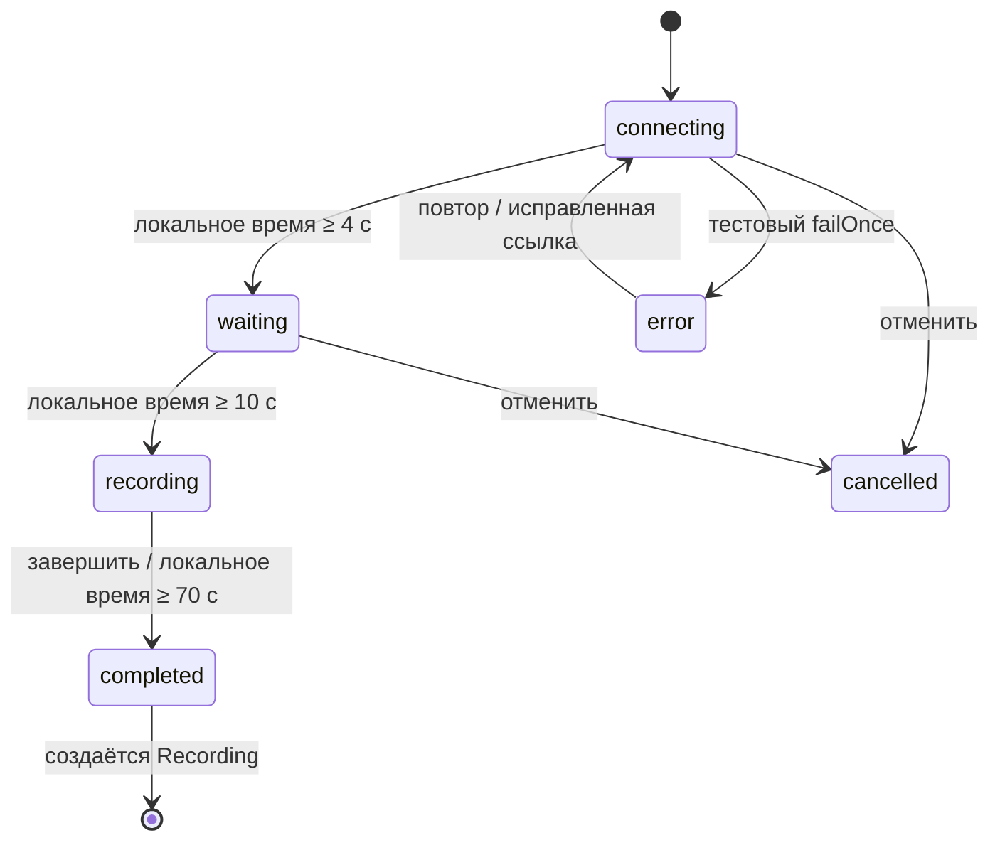

# Сценарии и правила поведения

Этот документ описывает поведение текущего десктопного прототипа без рабочих
вкладок. Он нужен разработчику, который переносит сценарии в настоящий клиент.
Карта экранов и правила возврата находятся в [описании навигации](01-product-navigation.md),
структуры данных — в [описании архитектуры](02-architecture-data.md).

Здесь «реализовано» означает, что сценарий работает в браузерной модели.
Сервер Thesis, захват аудио, агент ВКС, распознавание и языковая модель к ней
не подключены. Тексты интерфейса о серверном хранении или доступе выражают
замысел сценария; они не доказывают работу соответствующей интеграции.

## 1. Добавить материал

### Диктофон и независимые черновики

Точка входа — «Записать» на списках записей. В общем списке место по умолчанию —
«Личное / Без папки». В пространстве наследуется его область, а при входе из
папки — её идентификатор. В списке пространства учитывается выбранный фильтр
папки. Фильтр пространства в общем списке не меняет место записи: для этого
нужно открыть само пространство. Полное место доступно в подсказке и доступном
описании кнопки, а в диктофоне его можно изменить.

Источники: [`RecordingAction`](../../src/RecordingAction.tsx),
`startRecording` в [`navigation.tsx`](../../src/navigation.tsx).

1. Создаётся `Draft` с собственным ID, названием, сервером, пространством,
   папкой, счётчиком секунд и состоянием паузы. При создании или продолжении
   одного черновика остальные переводятся на паузу.
2. На экране диктофона доступны название, место отправки, папка, пауза,
   продолжение, «Заново» и «Завершить». Смена области/сервера сбрасывает
   несовместимую папку. Пока место недоступно, завершение не создаёт запись.
3. «Заново» обнуляет время и запускает счётчик, сохраняя название и место.
   Если уже есть фрагмент, сначала показывается подтверждение. Само открытие
   подтверждения не приостанавливает запись.
4. «Завершить» создаёт `Recording` и удаляет только завершённый черновик.
   Длительность — не меньше одной секунды. Затем открывается обзор записи.

При попытке уйти с диктофона пользователь выбирает действие:

| Действие | Результат |
| --- | --- |
| Сохранить черновик и выйти | Черновик остаётся, счётчик ставится на паузу, выполняется запрошенный переход |
| Завершить и отправить | Проверяется место, создаётся запись, открывается её обзор |
| Удалить и выйти | После отдельного подтверждения удаляется только этот черновик |
| Закрыть диалог | Пользователь остаётся в диктофоне; предыдущее состояние записи сохраняется |

Счётчик не останавливается от открытия диалога выхода. После восстановления
приложения все сохранённые черновики загружаются на паузе. Выход из профиля и
смена сервера также ставят их на паузу, но не удаляют.

Источники: [`RecorderPage`](../../src/creation.tsx), диалоги выхода в
[`navigation.tsx`](../../src/navigation.tsx), действия `create-draft`,
`update-draft`, `finish-draft`, `hydrateState` в [`model.ts`](../../src/model.ts).

**Граница реализации:** анимация и секундомер имитируют запись. Разрешение
микрофона не запрашивается, аудиофайл не создаётся. Свежий черновик не получает
выдуманную транскрипцию: после локального цикла обработки он может завершиться
с признаком `noSpeech` и без текстовых материалов.

### Импорт аудио/видео

«Добавить» открывает загрузку файла. Поддержаны выбор и перетаскивание одного
файла; из набора при перетаскивании берётся первый. Проверяется непустой файл и
расширение `mp3`, `m4a`, `wav`, `ogg`, `aac`, `flac`, `mp4` или `webm`.
Это проверка формы, не проверка содержимого или серверного декодирования.

После выбора имя без расширения становится редактируемым названием, можно
выбрать пространство. Новая импортированная запись создаётся в его корне
(`folderId: null`). Браузер пытается прочитать только длительность через временный
`audio`/`video` и `Object URL`; ожидание ограничено четырьмя секундами. Ошибка
чтения длительности допускает импорт с `duration: null`. Смена файла защищена
от результата устаревшего асинхронного чтения.

В локальную модель попадают метаданные, а не бинарное содержимое выбранного
файла. Настоящего хранения или отправки исходника нет. Статус новой записи —
`uploading` либо `local` с запрошенной отправкой, если демонстрационное состояние
сети запрещает отправку. См. [`ImportDialog`](../../src/creation.tsx) и
[проверки импорта](../../tests/import-validation.spec.ts).

### Запись встречи по ссылке

Форма принимает полную HTTPS-ссылку, имя агента (1–60 символов), необязательное
название (до 120 символов) и пространство. Название по умолчанию — «Встреча по
ссылке». Выбранное имя агента сохраняется в настройках для следующего запуска.
При `offline` подключение недоступно. Параметр `bridge-profile=missing` показывает
отсутствие профиля агента и блокирует новые подключения.

Повторное добавление той же нормализованной ссылки на том же сервере при
`connecting`, `waiting` или `recording` открывает существующее подключение.
Модель не создаёт дубликат активной попытки.

Это расписание демонстрации в `tick`, а не ожидаемые сроки работы реального
агента. `bridge-outcome=error` создаёт тестовый отказ примерно через 3,5 секунды.
Пауза доступна только на этапе записи и исключается из отображаемой
длительности. При демонстрационном `offline` переходы агента не обновляются,
управление отключено, показывается последнее известное состояние. Это не
утверждение, что реальный агент остановился.

Отмена до начала записи не создаёт `Recording`. Завершение во время записи
создаёт один результат с `bridgeId`, переводит его в обработку, а экран
подключения начинает показывать `RecordPage` для результата. После ошибки можно
повторить, изменить ссылку или удалить только неудачную попытку. Для удаления
попытки не должно быть результата.

Источники: [`MeetingDialog`, `MeetingPage`](../../src/creation.tsx),
`meetingDuration`, `meetingResult`, `connect-meeting`, `stop-meeting`,
`retry-meeting`, `dismiss-meeting`, `tick` в [`model.ts`](../../src/model.ts).

## 2. Отправка, обработка и восстановление

Статус записи и доступность каждого материала вычисляются отдельно.
Проверять только `status === 'ready'` недостаточно: во время повторной обработки
статус может оставаться `ready`, а операция задаётся в `operation`.

| Состояние | Что видит пользователь | Восстановление |
| --- | --- | --- |
| `local`, отправка не запрошена | «На устройстве», текстов ещё нет | «Отправить запись» |
| `local`, `uploadRequested: true` | Ожидаем подключение / Wi-Fi либо готовим отправку | Автоматическое продолжение при подходящей сети, пока открыт прототип |
| `uploading` | Отправка с демонстрационным процентом | При запрете сети возвращается в `local`, запрос отправки сохраняется |
| `upload-error` | Файл остаётся локально | Ручной повтор отправки |
| `processing` | Распознавание, подготовка резюме или спикеров | Чтение уже доступной части; ожидание этапа |
| `processing-error` | Ошибка конкретного этапа | Повторяется соответствующий этап, а не вся цепочка безусловно |
| `ready` без `operation` | Готовые доступные материалы либо «Речь не обнаружена» | По меню доступны отдельные операции |
| `ready` с `operation` | Старые материалы и отметка об обновлении | Дождаться результата; редактирование и новые операции блокируются |

`waitingReason` учитывает `settings.network` и `wifiOnly`. Эта сеть — значение
демонстрационной модели, не данные ОС. По согласованному решению её переключатель
удалён из настроек десктопа; ранее сохранённый `offline`/`mobile` продолжает
влиять на сценарии. Это существенный случай для диагностики «кнопка не работает».

Повтор недоступен при запрете изменения (`canManage: false`), другом сервере,
недоступном пространстве или несовместимом состоянии сети. Причина отображается
рядом с действием. Уже запрошенная ожидающая отправка не предлагает повторный
ручной запрос. Ошибка отправки сама не возобновляется.

Повторные операции подтверждаются отдельно:

- **Переобработать запись:** заново пройти распознавание и подготовку резюме;
  существующие материалы остаются видимыми с отметкой предыдущей версии.
- **Пересоздать резюме:** использовать текущую транскрипцию, не менять реплики
  и спикеров.
- **Идентифицировать спикеров:** отдельная операция; текст и резюме сохраняются.
  В текущей модели она заканчивается сменой состояния и не распознаёт новые имена.

Источники: `statusPresentation`, `materialPresentation`, `retryPresentation`,
`advanceRecord`, `versionNotice` и действия `operation`/`retry-record` в
[`model.ts`](../../src/model.ts); [`RecordMenu`](../../src/record-actions.tsx).

**Граница реализации:** прогресс меняется по локальному `tick` раз в секунду.
Это не поток событий задания. Проценты, сроки, ошибки `frozen` из демоданных и
`failOnce` нельзя переносить в договорённость с сервером. Текущая модель не
добавляет выдуманную речь к пустому входу.

## 3. Читать и исправлять запись

Внутри записи остаются три вкладки материалов: «Обзор», «Транскрипция»,
«Ассистент». Отсутствие рабочих вкладок окна не означает отказ от этих вкладок.
Технические сведения и список спикеров находятся в панели свойств.

### Обзор и версии

Обзор объединяет название, источник, дату, длительность, количество реплик и
спикеров, резюме и действия над ним. Наличие текста контролируют
`materials` и `materialAvailable`; пустой или ещё недоступный материал имеет
своё состояние ожидания/ошибки. Частичная транскрипция читаема во время
распознавания, резюме первичной обработки до готовности не подставляется из
неподтверждённых данных.

Изменение текста реплики увеличивает `transcriptRevision`. Если
`summaryRevision < transcriptRevision`, резюме помечается как устаревшее и
предлагается пересоздать его вручную. Редактирование не подменяет резюме
автоматически. Копирование и экспорт включают соответствующее предупреждение.

### Транскрипция, поиск и редактирование

- Реплика содержит спикера, начало/конец и текст. Список спикеров вычисляется
  из реплик, а не из участников пространства или встречи.
- Фильтр «Спикер» ограничивает показываемые реплики и область поиска.
  Поиск регистронезависимый, посимвольный, внутри отдельных реплик.
- `⌘/Ctrl+F` в транскрипции переводит фокус в её поиск. `Enter` и
  `Shift+Enter` переходят между совпадениями. `Escape` очищает поиск,
  восстанавливает позицию до поиска и оставляет фокус в поле.
- Текущее совпадение прокручивается в читаемую область под закреплённой панелью.
  Частичный текст явно подписан «по распознанной части».
- Кнопка реплики и таймкод меняют позицию общего плеера; активная реплика
  определяется по интервалу `start <= position < end`.
- Редактирование одной реплики требует непустого текста и
  `canEditTranscript`. Сохранение — кнопкой или `⌘/Ctrl+Enter`, отмена —
  кнопкой или `Escape`. Правка сохраняется в локальной модели.
- «Улучшить текст» приводит пробелы и пробелы перед пунктуацией к единому
  оформлению. Это не AI-редактура; имена и таймкоды сохраняются.

Правку блокируют активная обработка/отправка, отсутствие текста или прав,
ошибка распознавания текущего этапа, чужой сервер и отсутствие сети для
серверного материала. Ошибка резюме при доступном тексте не равна ошибке
распознавания: ограничения различаются.

Источники: [`RecordPage`](../../src/RecordPage.tsx), `findTranscriptMatches`,
`segmentAtTime`, `transcriptEditReason`, `edit-transcript` в
[`model.ts`](../../src/model.ts). Состояние поиска и незавершённой правки
удерживает навигационная сессия; детали возврата — в
[документе о навигации](01-product-navigation.md).

### Плеер и видео

Плеер общий для оболочки: позиция, воспроизведение, скорость, перемотка ±30 секунд
и ползунок. Скорости: `0.75`, `1`, `1.25`, `1.5`, `2`. Позиция и скорость
запоминаются в памяти по паре `[server, recordId]` при переключении записи;
новая активная запись выбирается на паузе. Смена сервера, выход или удаление
доступной записи очищают несовместимое состояние плеера.

У записи ВКС есть раскрываемый видеоблок в свойствах. Его управление
синхронизировано с тем же плеером. Вместо изображения показано, что файл не
подключён; постороннее видео не подставляется. При неизвестной/нулевой
длительности транспорт недоступен.

Источники: [`PlaybackProvider`, `PlayerDock`, `RecordVideo`](../../src/playback.tsx).
**Граница реализации:** позицию двигает таймер; звука, изображения и реального
медиадекодера нет. Позиции не являются доказательством реального медиапотока.

## 4. Задавать вопросы по записям

### История и контекст

Глобальный Ассистент содержит общую историю текущего сервера/владельца и экран
диалога. У диалога есть название, черновик вопроса, область источников `Scope`
и последовательность `Turn`. Пустой безымянный диалог без черновика не засоряет
общую историю. Название первого вопроса становится заголовком, если пользователь
не назначил своё. Поиск истории учитывает название, область, черновик, вопросы
и доступные готовые ответы.

Начальный глобальный диалог использует все подходящие доступные записи;
контекстный — выбранную область/папку. Место хранения записи и область ответа
Ассистента — разные понятия. Фильтры каталога не являются автоматическим
источником вопроса. Глобальный композер явно показывает контекст и материалы.

Новые диалоги вкладки записи создаются с явным `recordContextId` и одним
`recordId`. При наличии подходящей истории вкладка также может показывать
прежний диалог с одним источником без этой метки. Это тот же объект, который
можно открыть в глобальном Ассистенте:
вопросы, ответы и черновик не копируются. Текущая реализация поддерживает
несколько диалогов по записи через меню истории. Новый диалог доступен после
начала текущего; если уже есть пустой, выбирается он. Создание нового не
переименовывает и не объединяет старые.

`recordDialogs` также находит старые глобальные диалоги с единственным
подходящим источником и без `recordContextId`; их связь не мигрируется
автоматически. Выбор диалога записи сохраняется отдельно по серверу, владельцу
и записи в обычном режиме. Во встроенном композере строка выбора источников
скрыта; контекст закреплён за записью.

Источники: [`RecordAssistant`, `DialogHistoryMenu`, `Assistant`](../../src/Assistant.tsx),
`visibleDialogs`, `recordDialogs`, `ensure-record-dialog` в [`model.ts`](../../src/model.ts).

### Выбор источников и снимок вопроса

`Scope.mode === 'auto'` означает все подходящие записи области, включая новые.
`explicit` означает выбранные идентификаторы. Явно пустой набор не расширяется
до «всех» — отправка блокируется. Папка и область также проверяются на доступность.
Локальная неотправленная запись не подходит как источник; нужен доступный
серверный материал с текстом.

До первого вопроса можно менять область, папку и отдельные записи. В поиске
источников массовые действия применяются к найденным записям, а не незаметно ко
всему набору. Недоступные выбранные записи показаны отдельно, чтобы можно было
исключить их. После первого вопроса, а для связанного с записью диалога — сразу,
набор настроек источников заблокирован. Для другого контекста нужно начать
другой диалог. Режим `auto` при этом остаётся динамическим: новые подходящие
материалы попадут в снимок следующего вопроса.

При отправке `sourceSnapshot` копирует текст, название, вид материала,
номер ревизии и возможную отметку состояния в `Turn.snapshots`:

1. Выбирается готовое неустаревшее резюме.
2. Если его нет, используется доступная транскрипция, включая частичную с
   явным уведомлением.
3. Если текста нет, вопрос не отправляется.

Снимок уже отправленного вопроса не меняется после редактирования записи.
Источники ответа — только реально использованные `usedRecordIds`, а не все
выбранные записи. При потере доступа к использованному источнику готовый ответ
скрывается. Повтор запроса требует доступности всех исходных снимков.

### Ожидание, остановка, повтор, переход к источнику

На диалог допускается один `pending`-вопрос. Пустой вопрос, `offline`, отсутствие
источника или уже идущий ответ блокируют отправку. `Enter` отправляет,
`Shift+Enter` добавляет строку; составной ввод через IME не отправляет раньше
времени. Черновик хранится в `AssistantDialog.draft`.

Остановка переводит `pending` в `stopped`, сохраняет вопрос и снимки и не
позволяет позднему `tick` выдать ответ. Повтор переводит тот же `Turn` обратно
в `pending` с тем же вопросом и снимками, не добавляя новый вопрос. После
перезагрузки незавершённый ответ становится ошибкой «Запрос прерван».
`assistant-outcome=error` моделирует первый отказ нового диалога.

Готовый ответ получается локальным поиском абзацев по словам вопроса
(`answerFromSnapshots`), с ограниченным набором выдержек из нескольких записей.
Это не LLM/RAG, не качество реального AI и не проверка полноты ответа. Остановка
не подтверждает, что серверный запрос действительно отменён.

Источник ведёт в обзор или транскрипцию целиком в зависимости от `material` в
снимке. Показывается версия ответа и предупреждение, если текущий материал
изменился. Старый снимок без `material` открывает обзор и не выдаёт это за точную
цитату. Поддержки перехода к подтверждённой реплике/таймкоду из AI-ответа нет.
При возврате восстанавливаются позиция ответа и фокус его источника.

Переименование диалога ограничено 90 символами. Удаление после подтверждения
удаляет локальную переписку и черновик без восстановления, сохраняя записи.
Копирование ответа использует Clipboard API; при отказе открывает текст для
ручного выделения. Источники: [`Assistant.tsx`](../../src/Assistant.tsx),
`sourceSnapshot`, `sourceError`, `send`, `stop-turn`, `retry-turn`,
`answerFromSnapshots`, `turnAccessible` в [`model.ts`](../../src/model.ts).

## 5. Пространства, папки и перемещение

Каталог содержит «Личное» отдельно от общих пространств. Счётчик пространства
включает видимые записи из его корня и папок, исключает черновики и подключения
агента без результата. Счётчик папки включает только серверные записи этой
папки. Эти величины не нужно смешивать со счётчиком общей библиотеки.

Создание пространства находится в каталоге. Требует сохранённого сервера,
демонстрационной сети и названия 1–80 символов. Пробелы нормализуются,
зарезервированные и дублирующиеся названия не допускаются. Пространство
создаётся пустым. Выбор коллег сохраняется как `invitationDrafts` со статусом
`not-sent`, а не как фактически отправленные приглашения.

Редактирование названия/описания через меню сохраняет локальную накладку
`workspaceDetails` для сервера/владельца. Описание ограничено 500 символами.
«Изменить участников» сохраняет локальный `memberSelections`; это демонстрационный
список, не операция управления ACL. Спикеры транскрипции, участники пространства
и выбранные коллеги не должны автоматически объединяться.

Источники: [`WorkspacesPage`, `MembersPage`](../../src/Pages.tsx),
[`CreateWorkspaceButton`](../../src/WorkspaceCreate.tsx),
[`WorkspaceRenameDialog`](../../src/WorkspaceRename.tsx),
[`WorkspaceInvitationEditor`](../../src/WorkspaceInvitations.tsx).

Папка принадлежит одному пространству и серверу. Подпункты «Без папки» и
«В корне пространства» — представления `folderId: null`, а не реальные папки.
Новые папки можно создавать в личном или общем пространстве. Старые папки без
пространства доступны через настройки хранения, но создавать новые такие
папки нельзя. Название папки 1–80 символов, не совпадает с системными пунктами
или другой папкой той же области/сервера. Изменение папок блокируется при
`offline`.

| Действие | Последствия |
| --- | --- |
| Переместить запись в папку | Только для серверной записи; папка должна принадлежать тому же серверу и пространству; область и предполагаемый доступ не меняются |
| Изменить пространство | Подтверждение изменения аудитории; запись перемещается, копия не создаётся; `folderId` очищается; материалы сохраняются |
| Удалить папку | Записи и соответствующие черновики сохраняются, папка сбрасывается; область остаётся прежней |
| Удалить запись | После подтверждения удаляется запись и её материалы из локальной модели; запись-источник пропадает из доступных AI-ответов |

Смена пространства не публикует диалоги Ассистента. Существующие снимки не
переписываются. При удалении записи сами диалоги также не удаляются каскадно:
использовавшие её ответы становятся недоступными. Переименование записи
сохраняет ID, ограничивает заголовок 120 символами.

Источники: [`FoldersPage`](../../src/Pages.tsx),
[`RecordMenu`](../../src/record-actions.tsx), `move-area`, `move-folder`,
`delete-folder`, `delete-record` в [`model.ts`](../../src/model.ts).
Реальный сервер должен подтвердить изменение аудитории, полномочия и удаление;
одних локальных `canManage`/`canRead` для реализации доступа недостаточно.

## 6. Экспорт, копирование и передача

У резюме и транскрипции доступны DOCX, HTML, MD, TXT и PDF. Для транскрипции
экспорт собирает таймкоды, спикеров и текст реплик. Доступность зависит от
наличия материала и `canExport !== false`. Предупреждение об устаревшей или
обновляемой версии включается в экспортируемый текст.

- DOCX/HTML/MD/TXT формируются локально и вызывают браузерное скачивание.
- DOCX — минимальный OOXML-документ, не обещание полного совпадения оформления
  со страницей записи.
- PDF открывает подготовленный HTML в отдельном окне и вызывает печать;
  пользователь сам выбирает «Сохранить как PDF». Прототип не знает, сохранён
  ли файл. При блокировке окна выводится понятная ошибка.
- HTML экранирует пользовательскую разметку; имя файла очищается от недопустимых
  символов. Экспорт не отправляет материалы на сервер.
- «Скачать аудио» недоступно: исходного файла у прототипа нет.
- «Поделиться» передаёт текст резюме через `navigator.share`, когда доступен.
  Ссылки, дающей доступ к записи, нет. При отказе системы используется текстовая
  форма с копированием; отмена системной передачи не считается ошибкой.
- Clipboard API имеет форму ручного копирования при отказе браузера.

Источники: [`RecordExport`](../../src/RecordExport.tsx),
[`record-export.ts`](../../src/record-export.ts), `share`/`copy` в
[`RecordPage`](../../src/RecordPage.tsx).

## 7. Подключение и настройки

При отсутствии авторизации приложение показывает вход. Адрес сервера можно
ввести без `https://`; разрешён только HTTPS-хост без пути, query, hash или
учётных данных. Проверяется синтаксис (`normalizeServer`), не доступность Thesis.
Затем задержка около 650 мс моделирует сохранение сервера и SSO-вход. Реального
редиректа в корпоративную систему нет; профиль демопользователя фиксирован.

Смена сервера требует подтверждения при наличии черновиков/неотправленных
записей, сбрасывает авторизацию и не переносит их в другую организацию.
Неотправленные записи остаются видимыми локально; отправка в чужой сервер
блокируется. Выход из профиля не очищает историю и черновики. Состояние
доступности серверных записей пересчитывается для текущего сервера.

| Раздел | Текущая реализация |
| --- | --- |
| Подключение | Сохранённый адрес, демонстрационный SSO-профиль, смена сервера; переключателя сети нет |
| Оформление | Светлая/тёмная тема, синяя/нейтральная/оранжевая палитра VINi; русский интерфейс, English — только демонстрационный выбор |
| Аккаунт | Фиксированный профиль и локальный выход |
| Запись и отправка | Выбор 64/128 кбит/с сохраняется, но не меняет кодирование; Wi-Fi влияет на демонстрационную очередь; удаление локального аудио — только сохраняемый выбор |
| Уведомления | Предпочтение сохраняется, но не управляет уведомлениями ОС и не запрашивает разрешение |
| Хранилище | Число объектов демоданных в браузере, не объём файлов диска; пояснения о локальной истории; вход к старым папкам без пространства |

При ошибке браузерного хранения интерфейс может продолжать работу в памяти,
но сохранение после перезагрузки не гарантировано. Не очищайте storage для
обхода этого состояния без явной задачи на сброс. В `?preview=1` модель каждый
раз берётся из демоданных, действия не записываются в её постоянный storage.
Оформление может первоначально читаться из сохранённых настроек, однако его
изменения в preview не сохраняются. Подробные ключи и восстановление — в
[архитектуре](02-architecture-data.md).

Источники: [`SettingsPage`, `LoginPage`](../../src/Pages.tsx),
[`store.tsx`](../../src/store.tsx), [`appearance.tsx`](../../src/appearance.tsx),
`normalizeServer`, `server`, `sign-in`, `sign-out`, `hydrateState` в
[`model.ts`](../../src/model.ts).

## 8. Что сохранить при переносе в настоящий клиент

1. Независимые черновики и явное решение о завершении/сохранении/удалении.
   Открытие диалога само по себе не завершает захват.
2. Раздельные понятия: источник записи, сервер, пространство, папка,
   предполагаемая аудитория, источники Ассистента, участники и спикеры.
3. Восстановление по ошибочному этапу; сохранение предыдущих и частичных
   материалов; связь ревизий резюме и транскрипции.
4. Явно пустые источники, неизменяемые снимки вопросов, повтор того же снимка,
   ограничение доступности ответов и отсутствие выдуманных точных цитат.
5. Одна сущность диалога в глобальной истории и во вкладке записи;
   независимость разных разговоров, даже если у них один источник.
6. Подтверждение изменения аудитории и удаления; отсутствие автоматической
   миграции локальных данных при смене сервера или публикации.
7. Проверка прав на сервере, реальное хранение/кодирование/очередь отправки,
   механика отмены фоновых заданий, медиаплеер и OS-интеграции проектируются
   отдельно. Текущие таймеры и локальные флаги не заменяют эти контракты.

Опорные проверки поведения: [модель](../../tests/model.test.ts),
[блокировка источников Ассистента](../../tests/assistant-source-lock.spec.ts),
[импорт](../../tests/import-validation.spec.ts),
[история диалогов записи](../../tests/record-history.test.ts),
[экспорт](../../tests/record-export.test.ts). Наличие теста в каталоге не
означает, что для приёмки подходит любая конфигурация запуска: нужные команды
и порт 4192 перечислены в главе 4.
